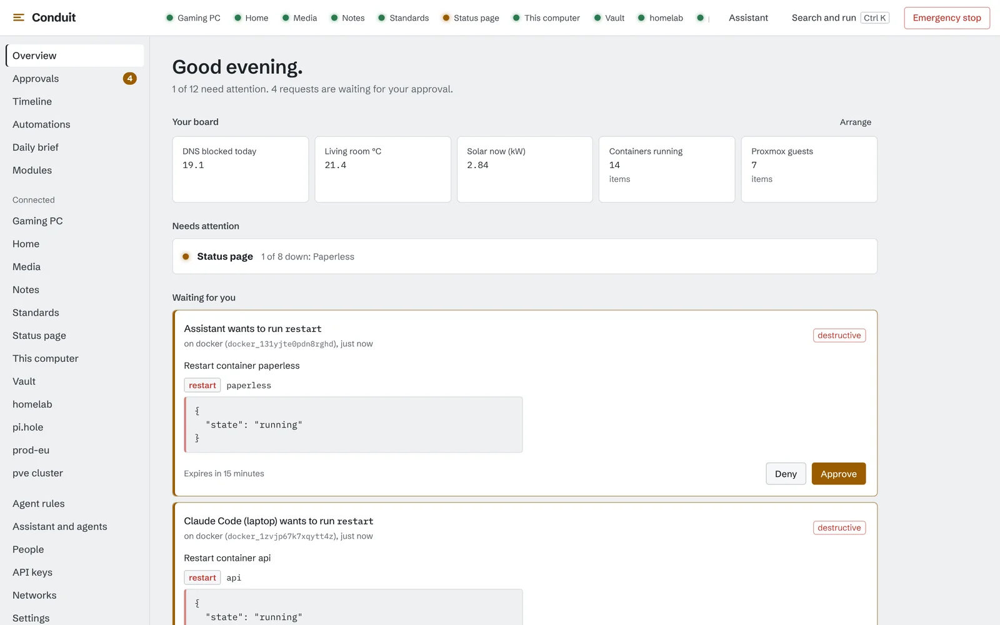
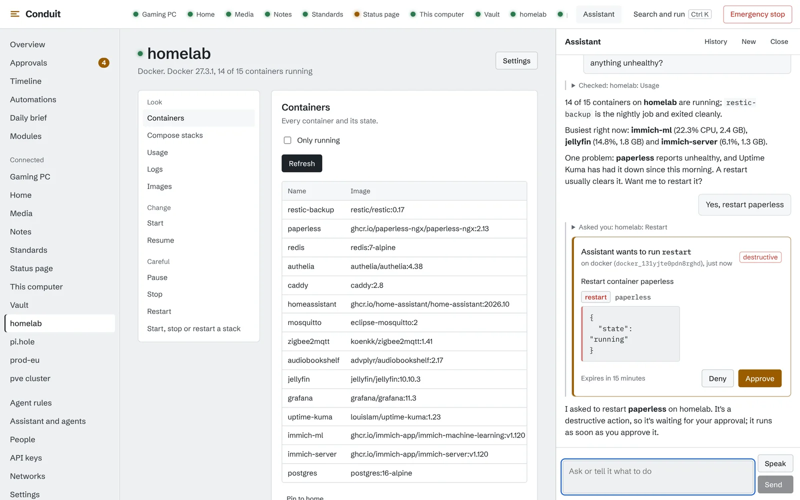
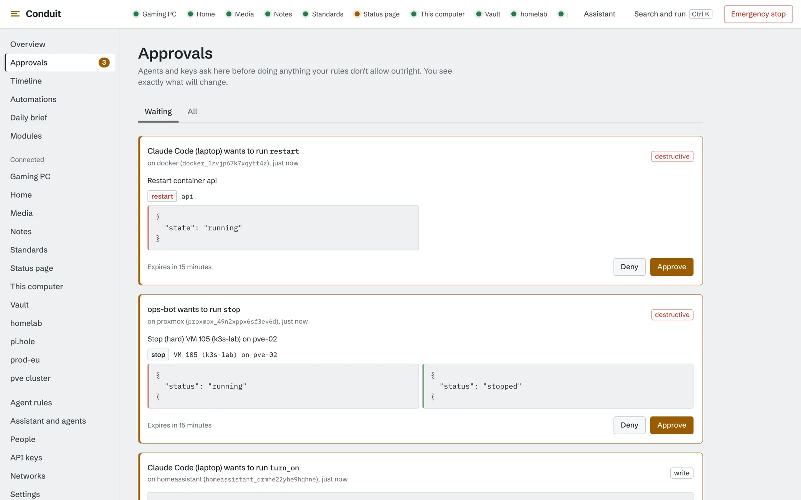
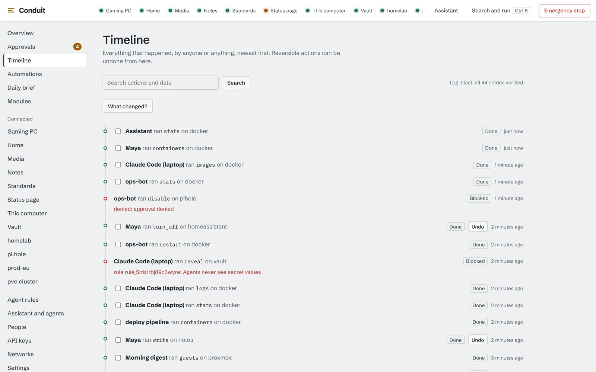
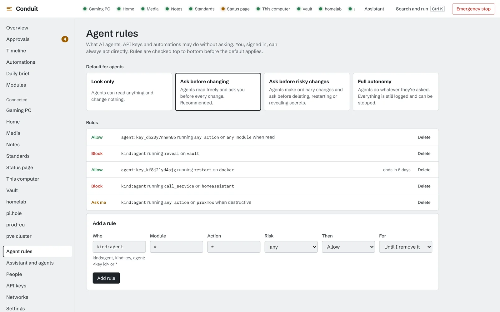
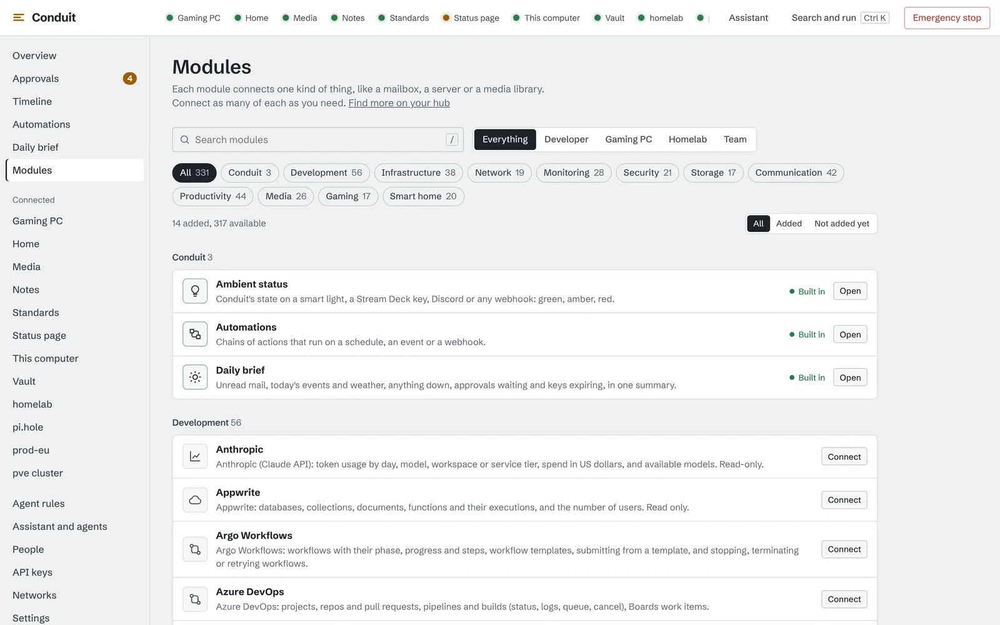
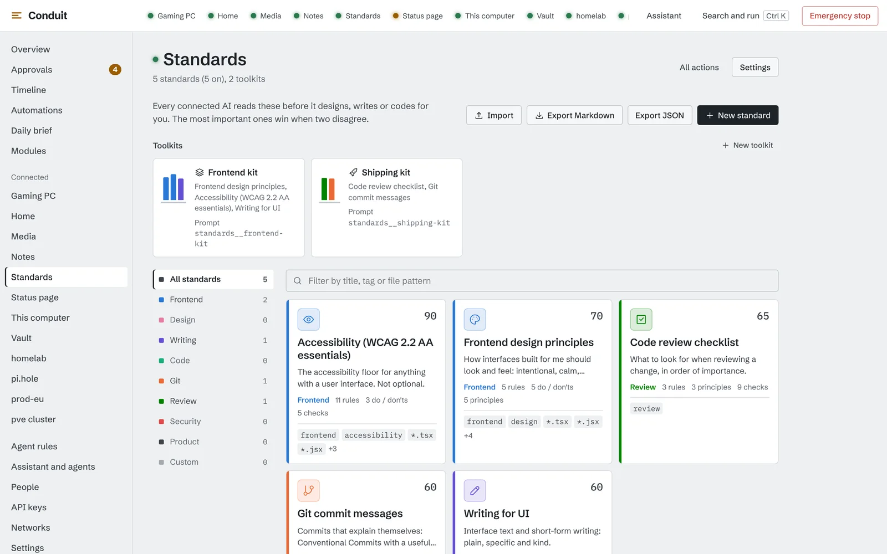
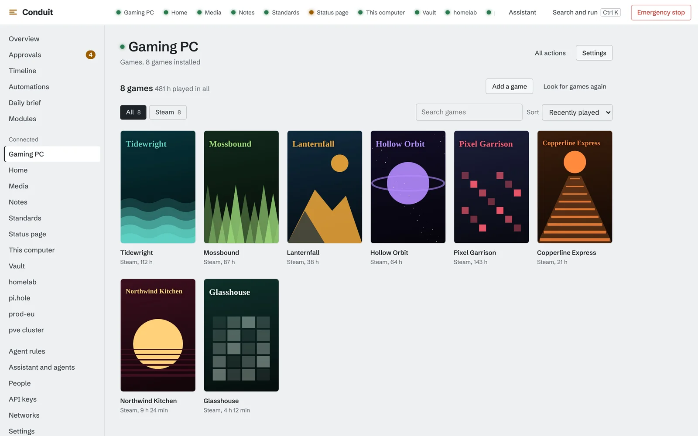
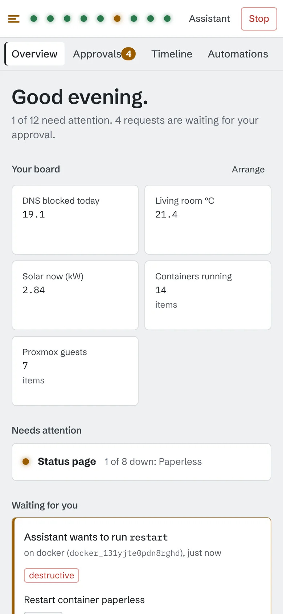

<p align="center"></p>

<h1 align="center">Conduit</h1>

<p align="center"><b>Everything you run, in one place. Your AI can drive all of it, and you stay in charge.</b><br>
331 built-in modules for servers, clouds, code, smart home, money, media and games.</p>

<p align="center">
  <a href="https://github.com/Elchi-dev/conduit/releases/latest"></a>
  <a href="https://github.com/Elchi-dev/conduit/actions/workflows/ci.yml"></a>
  
  
  <a href="LICENSE"></a>
  <a href="#built-with-ai"></a>
  <a href="https://github.com/Elchi-dev"></a>
</p>

<p align="center">
  <picture>
    <source media="(prefers-color-scheme: dark)" srcset="docs/images/home-dark.webp">
    
  </picture>
</p>

---

## Overview

Your servers are in one dashboard, your containers in another, DNS somewhere
else, the smart home in an app, the game servers in a panel and the payments
in a fourth browser tab. And now every AI assistant wants an API key to all of
it.

Conduit puts everything in one place. Connect a service once and it shows up
on your home screen, in the command bar, on your phone and in every AI you
use. Ask Claude, ChatGPT, a local model or the built-in assistant to restart a
container, check last night's backups, pause DNS blocking for five minutes or
refund an order, and it can. Within the rules you set.

**One app for the whole stack**, whether that's a homelab, a game server, a
startup's production or a company team.

---

## The trick

**Every action declares how risky it is, and Conduit decides what happens
next. Not the AI.**

```
        an AI, a script or you asks for an action
                         |
                         v
          read only? (status, logs, lists)  -------- yes ------->  runs now
                         | no
                         v
          your rules for this agent and this module
                         |
         +---------------+----------------+
         |               |                |
       allow            ask             block
         |               |
         |               v
         |     exact preview on your phone or desktop:
         |     "refund 49.00 EUR to order #1042"
         |     approve with your fingerprint
         |               |
         v               v
       runs, recorded in a tamper-evident audit log, undo one click away
```

What that gives you:

- **AI that asks first.** Agents never get more than the person they act
  for. Anything that spends money, posts publicly, changes access, opens a
  door or silences an alert waits for your approval under the default rules.
- **You approve exactly what you saw.** Refunds, payments and newsletter
  sends carry the values from their preview. If the order changed in
  between, the run is refused, so nothing can slip past an old approval.
- **A way back.** Most changes can be undone with one click. One button stops
  every agent at once.
- **Secrets stay secret.** Keys live in Conduit's vault. Modules ask for them
  by name, and no AI ever sees a password.

---

## A quick look

| | |
| --- | --- |
|  |  |
| **Ask in plain words.** The assistant checks your containers, spots the unhealthy one and asks before restarting it, right in the chat. | **Approvals** show exactly what will change, before and after. Approve on your desktop, or on your phone with your fingerprint. |
|  |  |
| **The timeline** records every action, who asked and who allowed it, in a log that checks itself. One click undoes a change. | **Rules** per agent, module and action, on top of four presets: read only, ask before changing, ask for risky things, or full autonomy. |
|  |  |
| **331 modules**, sorted by what you do, with starter sets for developers, gamers, homelabs and teams. | **Your standards** travel with every AI you connect: how your frontends look, how your commits read, what never to do. |
|  |  |
| **Your game library** from every launcher in one grid, with play time and one-click play. | **On your phone**, the same overview, alerts and approvals, end-to-end encrypted. |

---

## Works with what you already run

| Area | A few of the 331 modules |
| --- | --- |
| **Servers and containers** | Docker, Kubernetes, Proxmox VE and Backup Server, TrueNAS, Unraid, Synology, Portainer, Incus, Xen Orchestra, SSH |
| **Clouds and hosting** | AWS, Azure, Google Cloud, Hetzner, DigitalOcean, OVHcloud, Vercel, Netlify, Fly.io, Cloudflare, Coolify |
| **Code and CI** | GitHub, GitLab, Forgejo, Bitbucket, Jenkins, Buildkite, TeamCity, Argo CD, Sentry, Snyk, SonarQube |
| **Monitoring** | Grafana, Prometheus, Uptime Kuma, Zabbix, Checkmk, Netdata, PagerDuty, Opsgenie, Statuspage |
| **Network and security** | Tailscale, NetBird, UniFi, OPNsense, MikroTik, OpenWrt, FRITZ!Box, Pi-hole, AdGuard, CrowdSec, Wazuh |
| **Identity and secrets** | Okta, Auth0, Keycloak, authentik, 1Password, Bitwarden, Infisical, HashiCorp Vault |
| **Smart home** | Home Assistant, Hue, Shelly, Zigbee2MQTT, ESPHome, openHAB, ioBroker, Homebridge, Tibber, SolarEdge |
| **Business** | Stripe, Shopify, WooCommerce, Paddle, HubSpot, Zendesk, Intercom, Mailchimp, Twilio, Cal.com |
| **Work** | Microsoft 365, Google Workspace, Slack, Jira, Linear, Notion, Asana, ClickUp, Nextcloud, Wiki.js |
| **Media and downloads** | Jellyfin, Plex, Immich, the *arr apps, qBittorrent, SABnzbd, Audiobookshelf, Navidrome |
| **Games and streaming** | A game library for Steam, Epic, GOG, Riot, Battle.net and more, Pterodactyl, Minecraft servers, Twitch, OBS, FACEIT |
| **AI** | Ollama, LM Studio, OpenRouter, LiteLLM, ComfyUI, Hugging Face, and the usage and spend of Anthropic and OpenAI |

The full list, with what each module can do: [docs/modules](docs/modules/README.md).
Missing one? Any MCP server plugs in as a module, and you can write your own in
Go, Python, TypeScript or any language ([kits](sdk/external/)), or run
untrusted ones in a WebAssembly sandbox.

---

## Bring your own AI

Conduit speaks the **Model Context Protocol**, so every tool on every module
is available to Claude, ChatGPT, Cursor, a local model or anything else that
speaks MCP. There is also a built-in assistant, a REST API with scoped keys
and signed webhooks. Whichever way an agent comes in, it passes the same
rules.

Every AI you connect also gets **your standards**: how your frontends should
look, how you write, what never to do. Set them once in Conduit and they
travel with every agent.

---

## Everywhere you are

- **Desktop app** for Windows, macOS and Linux, with a tray icon and a
  command bar for everything.
- **Android app** that pairs with a QR code and confirms approvals with your
  fingerprint.
- **Remote access** through a hub you run, end-to-end encrypted, so nothing
  opens on your home network. Or keep it local only.
- **A command-line tool** and a browser app.
- **English and German**, in the app and on the website.
- **Updates that install themselves**, signed, with automatic rollback for
  the daemon.

---

## Install

**Desktop and Android:** download the installer for your system from the
[latest release](https://github.com/Elchi-dev/conduit/releases/latest) and
run it. The desktop app starts Conduit for you and opens it.

**A server or a headless machine:**

```sh
# Linux and macOS
curl -fsSL https://raw.githubusercontent.com/Elchi-dev/conduit/main/scripts/install.sh | sh -s -- --service
```

```powershell
# Windows, in PowerShell
irm https://raw.githubusercontent.com/Elchi-dev/conduit/main/scripts/install.ps1 | iex
```

The installer checks every download against the release's signed
`SHA256SUMS`. Then open `http://127.0.0.1:7600`, create your account and
connect your first module.

**Docker:**

```sh
docker run -d --name conduit -p 127.0.0.1:7600:7600 -v conduit:/data ghcr.io/elchi-dev/conduitd
```

All options, services and the hub: [docs/install.md](docs/install.md).

**Where to start:** guides for [homelabs](docs/guides/homelab.md),
[developers](docs/guides/developers.md), [teams](docs/guides/teams.md) and
[gamers](docs/guides/gamers.md).

---

## What is in it

| Part | What it does |
| --- | --- |
| **Home** | Tiles with the live health of everything you connected, and a daily brief of what needs you. |
| **Modules** | 331 built in, any MCP server as a module, a marketplace for signed community modules with ratings and reviews. |
| **Agents** | MCP for any AI client, a built-in assistant, API keys with scopes, signed webhooks. [docs/api](docs/api/README.md) |
| **Rules and approvals** | Presets, rules per agent, module and action, approvals with exact previews, one-click undo, an emergency stop. |
| **Audit** | Every action in a tamper-evident log, with who asked and who allowed it. |
| **Vault** | Every key and password in one place, restricted folders for teams, leak checks and encrypted backups. |
| **Automations** | Triggers, schedules and webhooks that run actions under the same rules. |
| **People** | Accounts with two-factor sign-in, passkeys and single sign-on for teams. |
| **Hub** | Your own server for remote access, sync between machines, phone pairing and the module marketplace. [docs/self-hosting](docs/self-hosting/README.md) |
| **Networks** | WireGuard networks that reach servers on private networks without touching your computer's network settings. |
| **Game library** | Steam, Epic, GOG, Riot, Battle.net, EA, Ubisoft, Xbox, itch.io and Lutris in one list, with one-click play and play time. |

Everything lives in one folder on your machine, backed up encrypted on a
schedule you choose.

---

## Non-goals

- **Not a cloud service.** Conduit runs on your machines. There is no account
  with me, and nothing leaves your network unless you connect a hub.
- **Not a replacement for each service's own app.** Conduit does the everyday
  things and points you to the service for the rest.
- **No telemetry, no ads.**

---

## Docs

| Document | What |
| --- | --- |
| [docs/install.md](docs/install.md) | Installing the apps, the daemon, the hub and the command-line tool |
| [docs/guides](docs/guides/README.md) | Step-by-step setups for homelabs, developers, teams and gamers |
| [docs/modules](docs/modules/README.md) | Every module, its actions and how risky each one is |
| [docs/api](docs/api/README.md) | MCP, the REST API, keys, webhooks and single sign-on |
| [docs/ARCHITECTURE.md](docs/ARCHITECTURE.md) | How the daemon, hub, modules and apps fit together |
| [docs/self-hosting](docs/self-hosting/README.md) | Running your own hub |
| [docs/protocol](docs/protocol/README.md) | The open protocol, external modules and the sandbox |
| [SECURITY.md](SECURITY.md) | What Conduit protects against, and how to report a problem |
| [docs/DECISIONS.md](docs/DECISIONS.md) | Why things are the way they are |
| [docs/ROADMAP.md](docs/ROADMAP.md) | What comes next |
| [CHANGELOG.md](CHANGELOG.md) | Releases |
| [CONTRIBUTING.md](CONTRIBUTING.md) | Building from source, tests and writing a module |

---

## Built with AI

Conduit is an **AI-assisted project**. Its code, tests and documentation were
written with Claude, an AI model by Anthropic, working on my direction: I
decided what Conduit should be, how it should behave and what it may do, and
Claude built it. Every change passes the automated test suite, and every batch
of modules went through an independent security review before it was merged.
How it was built, step by step, is in [docs/BUILD_LOG.md](docs/BUILD_LOG.md).

---

## License

MIT. See [LICENSE](LICENSE).

**Made by Elchi**
